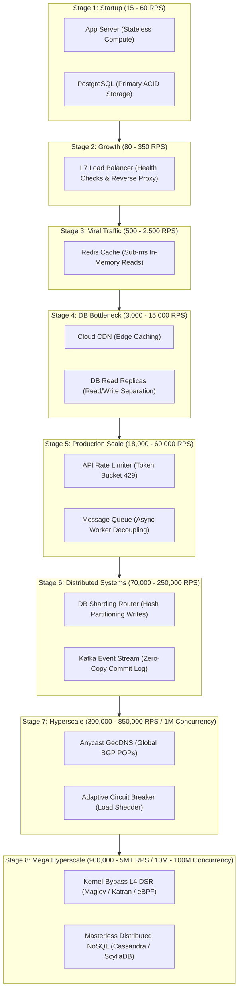
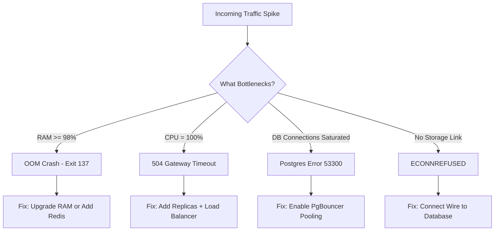

# Scale or Fail: The System Design Survival Game

> **Tagline:** *Build Small. Scale Big. Never Go Down.*

[](https://nextjs.org/)
[](https://www.typescriptlang.org/)
[](https://tailwindcss.com/)
[](https://reactflow.dev/)
[](https://vitest.dev/)
[](https://recharts.org/)

**Scale or Fail** is a browser-based distributed systems architecture simulator and strategy survival game. 

Unlike static quizzes or visual drag-and-drop diagramming tools, **Scale or Fail** is a deterministic, discrete-time engineering simulation backed by **Little’s Law** ($L = \lambda \cdot W$), Kingman’s queueing approximations, and real-world failure mechanics (thread starvation, OOM crashes, connection pool exhaustion, and single-primary write bottlenecks).

You start with a bootstrap web architecture: a single application server, a PostgreSQL database, and a modest infrastructure budget. As traffic grows organically and viral flash-crowds surge, you must inspect real-time metrics, identify infrastructure bottlenecks, and redesign your system topology to survive up to **1,000,000 concurrent requests**—and beyond into **Hyperscale (10M to 100M requests)**.

---

## Table of Contents

1. [Game Overview & Core Rules](#game-overview--core-rules)
2. [Difficulty Modes: Comparison Matrix](#difficulty-modes-comparison-matrix)
3. [8-Stage Architectural Progression Roadmap](#8-stage-architectural-progression-roadmap)
4. [Infrastructure Toolbox & Component Specifications](#infrastructure-toolbox--component-specifications)
5. [Topology Editing: Connecting & Disconnecting](#topology-editing-connecting--disconnecting)
6. [Server Down Incident Diagnosis & Remediation](#server-down-incident-diagnosis--remediation)
7. [4-Panel Observability Dashboard](#4-panel-observability-dashboard)
8. [Simulation Engine & Mathematical Model](#simulation-engine--mathematical-model)
9. [Technology Stack & Project Architecture](#technology-stack--project-architecture)
10. [Local Development & Testing](#local-development--testing)

---

## Game Overview & Core Rules

1. **Discrete-Time Simulation:** The simulation advances second-by-second (ticks) off the main thread inside a dedicated Web Worker. Metrics are calculated mathematically from real graph connectivity—no fake random numbers.
2. **There is No Final Victory:** Traffic increases continuously with periodic viral spikes. The player survives as long as their system maintains SLA availability and financial solvency.
3. **The 1 Million Concurrency Milestone:** Surviving **1,000,000 simultaneous in-flight requests** unlocks the prestigious title:
   > `ARCHITECTURE MASTER — You've designed a system capable of surviving 1 million concurrent requests in this simulation.`
   Traffic then escalates further into Mega Hyperscale (10M–100M).
4. **Economics:** Every node costs an hourly rate deducted from your operating budget. Successful requests generate revenue, while SLA outages (>5% error rate or >3000ms latency) impose severe financial penalties.
5. **Game Over Conditions:**
   - **Financial Bankruptcy:** Budget drops to $0.
   - **Sustained System Collapse:** Sustained error rate (>50%) or complete outage for consecutive seconds breaches the SLA threshold, triggering the **Postmortem Incident Report**.

---

## Difficulty Modes: Comparison Matrix

Scale or Fail features three distinct difficulty modes tailored for learning, production simulation, and chaos engineering:

| Feature / Dimension | 🟢 Beginner Mode (Guided Learning) | 🟡 Intermediate Mode (Production Realism) | 🔴 Expert Mode (Chaos & Hyperscale) |
| :--- | :--- | :--- | :--- |
| **Primary Goal** | Teach system design principles, bottlenecks, and component roles. | Test realistic capacity planning and architectural trade-offs. | Brutal stress-testing for senior architects and distributed systems veterans. |
| **Traffic Volatility (Jitter)** | **$\pm 4\%$ Micro-jitter**: Smooth, predictable baseline traffic curves. | **$\pm 14\%$ Volatility**: Realistic bursty traffic and unexpected dips. | **$\pm 25\%$ Volatility**: Severe traffic swings and extreme viral spikes. |
| **Viral Spike Multiplier** | **$1.3\times$ Multiplier**: Moderate surges allowing ample reaction time. | **$1.6\times$ Multiplier**: Steep surges requiring proactive scaling. | **$2.2\times$ Multiplier**: Aggressive viral waves that punish inadequate buffering. |
| **Failure SLA Threshold** | **$12$ Sustained Crash Ticks**: Generous learning window before game termination. | **$8$ Sustained Crash Ticks**: Realistic production SLA tolerance. | **$5$ Sustained Crash Ticks**: Zero tolerance for downtime—catastrophic failure occurs almost immediately. |
| **Incident Diagnosis Banner** | **Full Step-by-Step Checklist**: Displays exact error, technical root cause, numbered fix checklist, and *"Inspect & Fix Server"* button. | **Symptom & Error Only**: Displays error code and affected node, but hides step-by-step answers, requiring you to diagnose the topology. | **Raw Alarm Only**: Minimalist alert (`"CRITICAL: Node degradation detected"`). No hints or recommendations provided. |
| **Contextual Hints** | **Active**: Contextual hints display in the bottom panel (e.g., *"Tip: Traffic will increase steadily. Monitor App Server CPU"*). | **Reduced**: Replaced with high-level operational indicators. | **Disabled**: Telemetry metrics only; zero hints provided. |
| **Economics & Budget** | **$500 Starting Credit**: Forgiving operating cost buffer. | **$350 Starting Credit**: Moderate financial pressure. | **$200 Starting Credit**: Unforgiving budget constraints. |

---

## 8-Stage Architectural Progression Roadmap

Components in the Toolbox are **progressively locked** and unlock automatically as traffic increases and real architectural bottlenecks emerge:



---

## Infrastructure Toolbox & Component Specifications

All 13 components are fully modeled with distinct capacities, operational costs, and connection constraints:

| Component | Unlocks At | Category | Real-World Analog | Capacity & Scaling Model | Cost |
| :--- | :--- | :--- | :--- | :--- | :--- |
| **Application Server** | **Stage 1** | Compute | Node.js / Go / Java | Tiers: Small (2C/4GB), Med (4C/8GB), Large (8C/16GB), XL (16C/32GB), 2XL (32C/64GB). Saturated when CPU = 100% or RAM ≥ 98%. | $0.04 - $1.10/hr |
| **PostgreSQL Database** | **Stage 1** | Storage | PostgreSQL Primary | ACID transactional store. Handles all writes and direct reads. Supports Connection Pooling (PgBouncer) and B-Tree indexing. | $0.06 - $1.40/hr |
| **Layer 7 Load Balancer** | **Stage 2** | Ingress | Nginx / AWS ALB | Distributes traffic via Round Robin or Least Connections. Performs active health checking and automated failover around crashed servers. | $0.05/hr |
| **Redis Cache** | **Stage 3** | Caching | Redis Cluster | Absorbs 85–90% of eligible read queries in sub-millisecond RAM, shielding database IOPS. Cache misses forward to connected DBs. | $0.08/hr |
| **Cloud CDN** | **Stage 4** | Edge | Cloudflare / Fastly | Caches static assets and public GET requests at global Points of Presence (POPs), absorbing 70% of GET traffic before reaching origin. | $0.05/hr |
| **Database Read Replica** | **Stage 4** | Storage | AWS Aurora Replica | Read-only SQL replica. Offloads query traffic from Primary DB. Does not process writes. | $0.05 - $1.19/hr |
| **API Rate Limiter** | **Stage 5** | Protection | Envoy / Token Bucket | Shields downstream servers by dropping burst traffic exceeding configured capacity with HTTP 429 Too Many Requests. | $0.02/hr |
| **Message Queue** | **Stage 5** | Decoupling | RabbitMQ / SQS | Buffers asynchronous writes and heavy background workloads (100,000 buffer), preventing worker thread stall. | $0.07/hr |
| **DB Sharding Router** | **Stage 6** | Storage | Vitess / Citus | Partitions write transactions across multiple DB shards by hash key ($\text{hash}(\text{id}) \pmod N$), breaking the single-primary write bottleneck. | $0.25/hr |
| **Kafka Event Stream** | **Stage 6** | Streaming | Apache Kafka / Redpanda | High-throughput distributed append-only commit log streaming millions of events/sec across partitioned consumer groups. | $0.18/hr |
| **Anycast GeoDNS** | **Stage 7** | Ingress | Anycast BGP Routing | Eliminates cross-continent transit bottlenecks by terminating traffic at 64+ edge POPs, cutting network latency by up to 35ms. | $0.15/hr |
| **Adaptive Circuit Breaker** | **Stage 7** | Resilience | Netflix Hystrix | Automatically sheds 25–50% of non-critical background traffic when system CPU exceeds 90%, preventing cascading total failure. | $0.03/hr |
| **Kernel-Bypass L4 (Maglev)** | **Stage 8** | Ingress | Meta Katran / Google Maglev | Direct Server Return (DSR) using eBPF/XDP. Backends reply directly to clients, bypassing proxy return bandwidth bottlenecks for 10M+ packets. | $0.12/hr |
| **Distributed NoSQL Store** | **Stage 8** | Storage | Apache Cassandra / DynamoDB | Masterless quorum replication ($W+R > N$) with linear horizontal write scaling and zero single point of failure. | $0.35/hr |

---

## Topology Editing: Connecting & Disconnecting

Modifying connections is intuitive and supports three methods:

```
          [ Client ] 
              │
              │  (Click '✕', press Backspace, or use Drawer)
              ▼
        [ App Server ]  ───►  [ PostgreSQL ]
```

1. **Direct On-Wire `✕` Disconnect Button (Fastest):**  
   Every connection wire features an interactive badge showing live throughput (e.g. `4,200 req/s`) and a circular **`✕`** button. Hovering and clicking this button instantly severs the link.
2. **Keyboard Shortcut (<kbd>Backspace</kbd> / <kbd>Delete</kbd>):**  
   Click any connection wire to select it (it glows cyan/blue), then press <kbd>Backspace</kbd> or <kbd>Delete</kbd>.
3. **Node Configuration Drawer:**  
   Click any node on the canvas to open the right-hand inspector. Under **"Connected Network Links"**, all inbound and outbound links are listed with source and target names and a dedicated red **`✕ Disconnect`** button.

### Example: Inserting a Load Balancer
1. Click the `✕` on the wire connecting `Client` $\to$ `App Server`.
2. Drag a **Load Balancer** and a second **App Server** from the Toolbox onto the canvas.
3. Draw wires:
   - `Client` $\to$ `Load Balancer`
   - `Load Balancer` $\to$ `App Server 1`
   - `Load Balancer` $\to$ `App Server 2`
   - Both App Servers $\to$ `PostgreSQL Primary`
4. The Load Balancer automatically starts health checking and distributing traffic evenly!

---

## Server Down Incident Diagnosis & Remediation

When a server crashes, the **Automated Incident Diagnosis Engine** detects the root cause and provides specific remediation instructions:



### The 5 Common Failure Modes

#### 1. Out Of Memory (OOM) Crash
* **Error Code:** `FATAL: Process Out of Memory (OOMKilled - Exit code 137). Worker thread heap exhausted under high in-flight concurrency.`
* **Root Cause:** In-flight concurrent requests exceeded server memory limits.
* **Remediation:** Click the server and upgrade tier from Small (4GB) to Large (16GB) or XL (32GB), or deploy a Redis Cache to offload reads.

#### 2. CPU Saturation & Thread Starvation
* **Error Code:** `HTTP 504 Gateway Timeout: Event Loop Lagged > 1500ms. CPU saturated at 100%, thread pool queue full.`
* **Root Cause:** Influx of requests exceeded vCPU compute capacity, stalling execution threads.
* **Remediation:** Add horizontal server replicas behind a Load Balancer, or upgrade instance tier to 8/16 vCPUs.

#### 3. Database Connection Pool Exhaustion
* **Error Code:** `PostgreSQL ERROR 53300: sorry, too many clients already. Database connection pool starved.`
* **Root Cause:** Multiple app server worker threads attempted to open direct connections to Postgres, exceeding `max_connections`.
* **Remediation:** Select PostgreSQL on the canvas and toggle **"Connection Pooling (PgBouncer)"** to `ON` (multiplexes connections to reduce overhead by 75%), or add Read Replicas.

#### 4. Disconnected Storage
* **Error Code:** `Unhandled Promise Rejection: ECONNREFUSED: No active database or cache target connected.`
* **Root Cause:** The server is receiving user requests but has no network connection to persistent storage.
* **Remediation:** Drag a connection wire from the App Server to PostgreSQL Primary or Redis.

#### 5. Downstream IOPS Thrashing
* **Error Code:** `Downstream IOPS Thrashing: Database read latency exceeded 1200ms, backing up upstream app server threads.`
* **Root Cause:** Sequential table scans on unindexed tables.
* **Remediation:** Select PostgreSQL and toggle **"Query Indexing (B-Tree)"** to `ON`.

---

## 4-Panel Observability Dashboard

The bottom panel renders **all 4 observability streams simultaneously** in real time—no tab clicking required:

```
┌───────────────────────┬───────────────────────┬───────────────────────┬───────────────────────┐
│ 1. Traffic (RPS)      │ 2. Latency (ms)       │ 3. Error Rate (%)     │ 4. Event Logs Stream  │
│                       │                       │                       │                       │
│ Incoming vs Succeeded │ Avg & p95 Curves      │ Error % vs 5% SLA     │ Live Alert Feed       │
│ AreaChart (Sky/Teal)  │ LineChart (Cyan/Amber)│ AreaChart (Rose)      │ Real-time Log Stream  │
└───────────────────────┴───────────────────────┴───────────────────────┴───────────────────────┘
```

1. **Panel 1: Traffic Throughput (RPS):** Incoming request volume vs. successfully processed requests and dropped traffic.
2. **Panel 2: Response Latency (ms):** Average latency and p95 tail latency curves with a red dashed line at the **3,000ms SLA Timeout Threshold**.
3. **Panel 3: Error Rate & SLA Compliance (%):** HTTP error percentage plotted against the **5% SLA Penalty Warning Threshold**.
4. **Panel 4: Live Event Logs Stream:** Real-time log feed showing timestamps, severity badges (`INFO`, `WARN`, `CRIT`), and technical events.
5. **Expand/Collapse Toggle:** Collapse the panel to maximize canvas real estate and expand it back with one click.

---

## Simulation Engine & Mathematical Model

The simulation logic in `packages/simulation` is completely framework-agnostic:

* **Little's Law ($L = \lambda \cdot W$):** Concurrency ($L$) is derived from arrival rate ($\lambda$) and mean residence latency ($W$).
* **Kingman’s Formula:** Queue wait time increases non-linearly as component utilization ($\rho$) approaches $1.0$:
  $$W_q \approx \frac{\rho}{1 - \rho} \cdot \left(\frac{c_a^2 + c_s^2}{2}\right) \cdot \frac{1}{\mu}$$
* **Deterministic PRNG:** Uses Mulberry32 seeding for 100% reproducible traffic spikes and simulation scenarios.
* **Edge-Driven Traversal:** Disconnected nodes consume zero traffic. Traffic routes strictly along defined edges with active health filtering.

---

## Technology Stack & Project Architecture

```
scale_or_fail/
├── app/                              # Next.js App Router root layout & main page
├── components/
│   ├── architecture/                 # React Flow workspace, custom nodes & edges
│   │   ├── edges/AnimatedFlowEdge.tsx# Custom SVG edge with live RPS & 1-click disconnect
│   │   ├── nodes/                    # Specialized node cards (Server, DB, Cache, Hyperscale)
│   │   ├── ArchitectureCanvas.tsx    # Interactive canvas with Backspace delete support
│   │   ├── NodeConfigDrawer.tsx      # Node inspector drawer with network links list
│   │   └── Toolbox.tsx               # 13-component toolbox with progressive stage locks
│   ├── game/                         # Header, Incident Banner, Postmortem & Milestone modals
│   └── monitoring/                   # 4-panel bottom observability & telemetry sidebar
├── packages/simulation/              # Core discrete-time simulation engine (framework-independent)
│   ├── core/                         # PRNG, types, domain models, ticker engine
│   ├── failures/                     # Failure detection, diagnosis & postmortem reports
│   ├── models/                       # Capacity calculations, Little's Law, queueing models
│   ├── routing/                      # Edge-driven graph traversal & topology validation
│   ├── traffic/                      # 8-stage traffic generator with deterministic spikes
│   └── tests/                        # Vitest unit test suites (21 unit tests passing)
├── stores/                           # Zustand state management (gameStore, architectureStore)
└── workers/                          # Web Worker for non-blocking off-thread simulation
```

---

## Local Development & Testing

### Prerequisites
- **Node.js:** v18.17+ or v20+
- **npm:** v9+

### Installation & Run

```bash
# Clone the repository
git clone https://github.com/your-username/scale-or-fail.git
cd scale-or-fail

# Install dependencies
npm install

# Run the development server
npm run dev
```

Open [http://localhost:3000](http://localhost:3000) in your browser.

### Running Automated Tests

```bash
# Run all Vitest unit tests (21 tests across 6 suites)
npm test

# Run Next.js production build check
npm run build
```

---

## License

MIT License. Designed and built for systems engineers, backend architects, and curious developers. Build small, scale big, and never go down!
